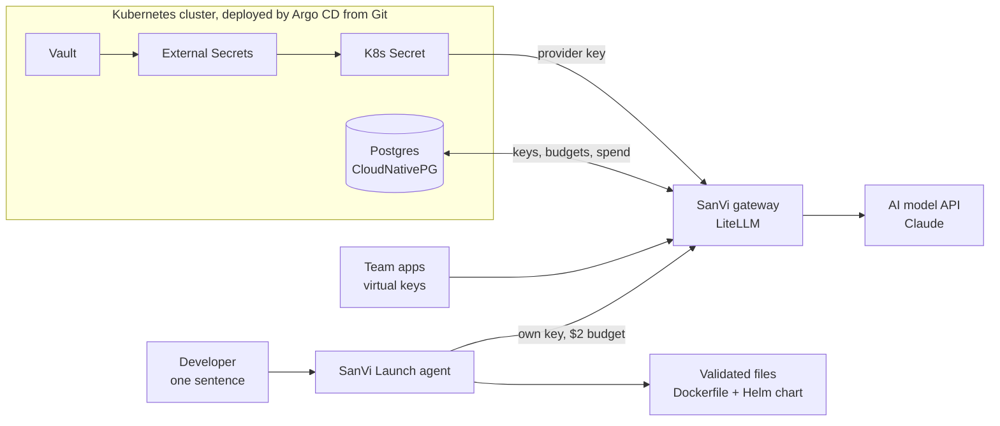

# SanVi

[](https://github.com/sandhilk/sanvi-gateway/actions/workflows/evals.yml)

**An open-source AI platform for Kubernetes.** A gateway that controls how a company uses AI (per-team keys, budgets, rate limits and cost tracking), and an agent that turns one sentence into validated deployment files.

> Personal open-source project, built in the open. Everything listed under "Works today" is running and tested.

## Works today
- **SanVi Gateway**: LiteLLM deployed from Git by one Argo CD root app (app-of-apps)
- **Keys never in code**: the provider key lives only in Vault and is synced in by External Secrets; rotation needs no redeploy
- **Per-team virtual keys** stored in Postgres (CloudNativePG), each with its own models, budget and rate limit
- **SanVi Launch agent**: one sentence in, Dockerfile + Helm chart out, validated with `helm lint`, `kubeconform` and a non-root rule; it feeds errors back and retries (up to 3 attempts)
- **Evals**: 5 fixed prompts (Python, Node, Go, Java); latest run **5/5 passed, avg 1.0 attempts, $0.18 total**

## Architecture


## How a request flows
1. An app calls the gateway with its **virtual key** (OpenAI-compatible API)
2. The gateway checks the key: no key gives 401, a fake key 400, a revoked key 401
3. It checks the key's **budget** and **rate limit**: over the limit gives 429; over budget is blocked
4. It forwards the call with the real provider key, which the app never sees
5. It logs the team, model, tokens and **cost**

## Tested
| Test | Result |
|---|---|
| Secret synced from Vault to Kubernetes | SecretSynced |
| Rotate the key in Vault | Updated in about 70 s, no redeploy |
| Whole platform from one Argo CD root app | All apps Synced and Healthy |
| No key / wrong key / valid key | 401 / 400 / answered |
| Rate limit 2 per minute | 200, 200, 429 |
| Budget exceeded | Blocked: "Budget has been exceeded" |
| Revoke a key | 401 instantly |
| Agent evals (5 prompts) | 5/5 passed, avg 1.0 attempts, $0.18 |

## Run the agent and evals
```bash
export SANVI_AGENT_KEY=<a gateway virtual key>
python3 agent/sanvi_launch.py "Deploy a Python FastAPI service called payments on port 8080 with 2 replicas"
python3 evals/run_evals.py        # exits 1 if the pass rate drops below 80%
```

## Lessons learned
- **Vault dev mode lost every secret on a restart.** The gateway stayed up because External Secrets kept the last good copy in Kubernetes, and Vault was restored from it. Production: HA Vault, persistent storage, auto-unseal.
- **An empty secret "syncs" successfully and fails later.** Validate secrets (length, format) before storing them.
- **Secrets passed as environment variables need a pod restart** after rotation. Production: Reloader.
- **Argo CD polls Git every 3 minutes.** Production: a Git webhook for near-instant sync.

## Roadmap
- **AI access as code**: teams, budgets and model access as YAML in Git, changed by pull request
- **Agent policy gate**: generated infrastructure must pass policy-as-code before a pull request opens
- **Zero static AI keys**: pods authenticate with their Kubernetes ServiceAccount via Vault
- Agent opens pull requests for human review; evals in CI; cost dashboards; one-command Helm install

## Lab notes
Runs on kind (in GitHub Codespaces). Vault runs in dev mode for local learning only. LiteLLM is the gateway engine; SanVi is the platform, security model and agent built around it.

---

Created by **Sandhil Kypa** · Licensed under [Apache 2.0](LICENSE) · See [NOTICE](NOTICE)

## Budget alerts and kill switch

Budgets alone cut a team off at 100% with no warning. SanVi adds two operator tools:

| Tool | What it does | Tested |
|---|---|---|
| `scripts/budget_watch.py` | Lists every key's spend against its budget: **OK**, **WARN** (80%+), **OVER** (100%+). Optional Slack-style webhook via `SANVI_ALERT_WEBHOOK`. Exits 2 when any key is at 80%+, so a CronJob or CI step can alert on it. | Demo key at 85% spend → `WARN team-demo (85%)` |
| `scripts/kill_switch.sh` | Reversible red button: `block <team>`, `block-all`, `unblock <team>`, `unblock-all`, `status`. Keys, budgets and history are kept. | `block team-demo` → **401**; `unblock` → **200** |

Use cases: a leaked key, a runaway agent loop, or an unexpected spend spike, stopped in seconds.

## Agent → pull request → human review

The agent never pushes to `main`. After a PASS, `agent/sanvi_pr.sh <app> "<request>"`:

1. Checks guard rails: valid app name, allowed repo (`SANVI_ALLOWED_REPOS`), clean working tree.
2. Re-runs `helm lint`, `kubeconform` and a non-root check on the output.
3. Copies it to `generated/<app>/` on a new `sanvi/<app>-<time>` branch.
4. Opens a pull request labelled `sanvi-agent`, with the request, files and validation results.

`generated/` is not watched by Argo CD, so merging never deploys anything by surprise. Example: [PR #1](https://github.com/sandhilk/sanvi-gateway/pull/1).

### Budget watch runs in the cluster (GitOps)
`apps/sanvi/budget-watch-cronjob.yaml` runs `budget_watch.py` every 15 minutes as a hardened CronJob: non-root, read-only filesystem, all capabilities dropped. It reaches the gateway over the cluster network and reads the admin key from the existing Secret, so no new secrets are needed. The script ships as a ConfigMap generated from `scripts/budget_watch.py`, a single source of truth.

A job **fails on purpose** when any team is at 80%+, so the failure *is* the alert. In production, the standard Prometheus `KubeJobFailed` rule pages on it, and the optional `budget-alerts` secret (`webhook` key) also posts to Slack.

Regenerate the ConfigMap after editing the script:
`kubectl -n sanvi create configmap budget-watch-script --from-file=budget_watch.py=scripts/budget_watch.py --dry-run=client -o yaml > apps/sanvi/budget-watch-configmap.yaml`

## AI access as code

Who can use which models, with what budget, lives in **`access/teams.yaml`**, changed only by pull request.

| Command | What it does |
|---|---|
| `scripts/access_sync.py --validate` | Checks the file against its policy (allowed models, max budget per team, max rpm). Runs in CI on every PR. |
| `scripts/access_sync.py` | **Plan:** shows what would change (`+ create`, `~ update`, `- block`, `= unchanged`). |
| `scripts/access_sync.py --apply` | Makes the gateway match the file. New keys go into Kubernetes Secrets `sanvi-key-<team>` and are never printed. |

Teams removed from the file are **blocked** (reversible), not deleted. Keys the tool didn't create are left alone.

**Tested:** two teams created; team-support's key calls `sanvi-mock` → **200** and is refused the paid model → **403**; a budget change in the file → `~ update` → applied → `= unchanged`. A greedy $50 request was **blocked by CI**: [PR #2](https://github.com/sandhilk/sanvi-gateway/pull/2).

### Merge = applied (GitOps)
On merge, Argo CD syncs `apps/sanvi/`, and a **PostSync Job** runs `access_sync.py --apply` inside the cluster:
- a ServiceAccount that may only manage Secrets in `sanvi` (least privilege), non-root, read-only filesystem
- `access/teams.yaml` and the script travel into the cluster as a ConfigMap (`./scripts/gen-configmaps.sh`), and CI fails if they drift

**Tested end to end:** a PR added `team-ml` → the access-policy check passed → merge → the Argo CD Job logged `+ create team-ml` and stored the key in `sanvi-key-team-ml`, with no manual apply.

## Right-Size Advisor: spend less without losing quality

Most teams send every request to their most expensive model. `scripts/rightsize.py` runs the **same eval suite** on each model and recommends the **cheapest one that keeps quality** (pass rate at least the baseline's and at least 80%). It never recommends a switch that loses quality.

**Result on the SanVi Launch workload (5 cases):**

| Model | Pass rate | Cost per run | Avg time per case |
|---|---|---|---|
| sanvi-smart (Claude Sonnet) | 5/5 | $0.2079 | 22.9s |
| sanvi-fast (Claude Haiku) | 5/5 | $0.0094 | 13.7s |

**Recommendation: switch this workload to sanvi-fast.** Same quality, 95% lower cost, 40% faster. At $50 a month that's about **$48 a month saved**. Full report: [`evals/rightsize-report.md`](evals/rightsize-report.md). Re-run it any time from **Actions → rightsize → Run workflow**.
