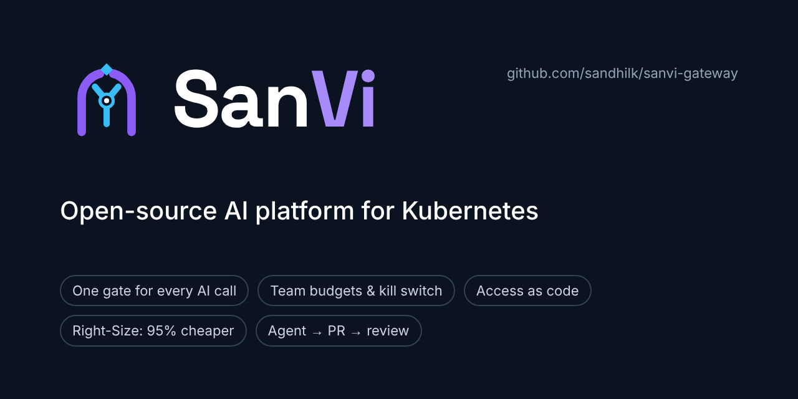
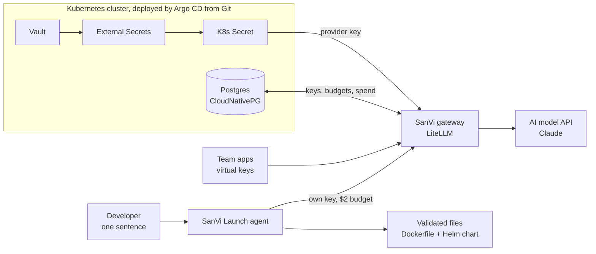
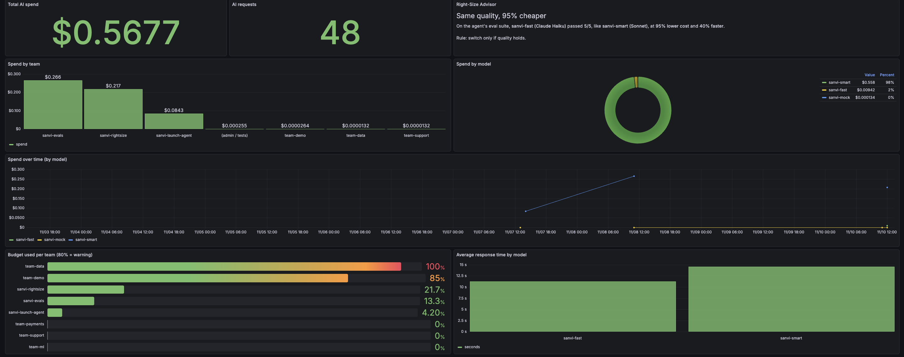

<p align="center"></p>

<h1 align="center">SanVi</h1>

<p align="center"><b>One gateway for every LLM your company uses, with budgets, a kill switch, evals in CI and audit-ready guardrails. Runs on your Kubernetes.</b></p>

<p align="center">
<a href="https://github.com/sandhilk/sanvi-gateway/actions/workflows/evals.yml"></a>
<a href="https://github.com/sandhilk/sanvi-gateway/actions/workflows/secure-pipeline.yml"></a>
<a href="https://github.com/sandhilk/sanvi-gateway/actions/workflows/compliance.yml"></a>
<a href="LICENSE"></a>
</p>

## Why SanVi
Every team wants to use AI. Finance wants to know what it costs, security wants to know where the keys are, and audit wants proof it's controlled. SanVi sits between your apps and the model providers and answers all three.

| | Result (measured, details below) |
|---|---|
| 💸 **Cheaper** | Right-Size Advisor: Claude Haiku matched Sonnet on the eval suite, **95% lower cost, 40% faster** |
| 🛑 **Safer** | Per-team keys, budgets and rate limits; **kill switch** blocks one team or everyone in seconds, reversibly |
| ✅ **Quality-gated** | Evals run in CI; changes **fail below 80%** pass rate |
| 🔐 **Keys never in code** | Provider keys live only in **Vault**; rotate with no redeploy (~70 s) |
| 📋 **Audit-ready** | 12-control evidence report mapped to ISO 27001, SOC 2 and EU AI Act themes, checked in CI |
| 🧑‍⚖️ **Human in the loop** | The deployment agent can only open **pull requests**, never push to `main` |

## What's inside
| Component | What it does |
|---|---|
| **SanVi Gateway** | OpenAI-compatible gateway (LiteLLM engine) with per-team virtual keys, budgets, rate limits and cost logging in Postgres |
| **Budget Watch + Kill Switch** | Warns at 80%, alerts at 100%, reversible block per team or all keys |
| **AI access as code** | Teams, models and budgets in `access/teams.yaml`, changed by pull request, applied by Argo CD |
| **Right-Size Advisor / Shadow Right-Sizer** | Finds the cheapest model that keeps quality, on fixed evals and on real-style traffic |
| **SanVi Launch agent** | One sentence in, validated Dockerfile + Helm chart out, delivered as a pull request |
| **Docs Assistant (RAG)** | LangGraph agent answering only from SanVi's docs, with sources and a refusal guardrail |
| **Compliance Evidence Report** | 12 controls checked against the real config and cluster, every change |
| **AI spend dashboard** | Grafana: spend by team and model, budget used, latency; cannot read prompts |
| **Secure pipeline** | gitleaks, Checkov, Kyverno, Trivy, Syft SBOM, cosign keyless signing |

## Architecture


## Quickstart
Prerequisites: Docker, [kind](https://kind.sigs.k8s.io/), kubectl, Helm, and a model provider API key.
```bash
git clone https://github.com/sandhilk/sanvi-gateway && cd sanvi-gateway
kind create cluster --name sanvi --config kind/cluster.yaml
helm install sanvi ./charts/sanvi -n sanvi --create-namespace   # secrets options: charts/sanvi/README.md
./demo.sh                                                        # GitOps, keys, rate limit, revoke, agent, evals
```
The full GitOps setup (Argo CD app-of-apps, Vault, External Secrets) starts from [`bootstrap/root-app.yaml`](bootstrap/root-app.yaml).

> Personal open-source project, built in the open. Every result in this README is from a real, repeatable test. Example figures in the shadow report use synthetic data and are labelled as such.

## How a request flows
1. An app calls the gateway with its **virtual key** (OpenAI-compatible API)
2. The gateway checks the key: no key gives 401, a fake key 400, a revoked key 401
3. It checks the key's **budget** and **rate limit**: over the limit gives 429; over budget is blocked
4. It forwards the call with the real provider key, which the app never sees
5. It logs the team, model, tokens and **cost**

## Budget alerts and kill switch

Budgets alone cut a team off at 100% with no warning. SanVi adds two operator tools:

| Tool | What it does | Tested |
|---|---|---|
| `scripts/budget_watch.py` | Lists every key's spend against its budget: **OK**, **WARN** (80%+), **OVER** (100%+). Optional Slack-style webhook via `SANVI_ALERT_WEBHOOK`. Exits 2 when any key is at 80%+, so a CronJob or CI step can alert on it. | Demo key at 85% spend → `WARN team-demo (85%)` |
| `scripts/kill_switch.sh` | Reversible red button: `block <team>`, `block-all`, `unblock <team>`, `unblock-all`, `status`. Keys, budgets and history are kept. | `block team-demo` → **401**; `unblock` → **200** |

Use cases: a leaked key, a runaway agent loop, or an unexpected spend spike, stopped in seconds.

## AI access as code

Who can use which models, with what budget, lives in **`access/teams.yaml`**, changed only by pull request.

| Command | What it does |
|---|---|
| `scripts/access_sync.py --validate` | Checks the file against its policy (allowed models, max budget per team, max rpm). Runs in CI on every PR. |
| `scripts/access_sync.py` | **Plan:** shows what would change (`+ create`, `~ update`, `- block`, `= unchanged`). |
| `scripts/access_sync.py --apply` | Makes the gateway match the file. New keys go into Kubernetes Secrets `sanvi-key-<team>` and are never printed. |

Teams removed from the file are **blocked** (reversible), not deleted. Keys the tool didn't create are left alone.

**Tested:** two teams created; team-support's key calls `sanvi-mock` → **200** and is refused the paid model → **403**; a budget change in the file → `~ update` → applied → `= unchanged`. A greedy $50 request was **blocked by CI**: [PR #2](https://github.com/sandhilk/sanvi-gateway/pull/2).

### Merge = applied (GitOps)
On merge, Argo CD syncs `apps/sanvi/`, and a **PostSync Job** runs `access_sync.py --apply` inside the cluster:
- a ServiceAccount that may only manage Secrets in `sanvi` (least privilege), non-root, read-only filesystem
- `access/teams.yaml` and the script travel into the cluster as a ConfigMap (`./scripts/gen-configmaps.sh`), and CI fails if they drift

**Tested end to end:** a PR added `team-ml` → the access-policy check passed → merge → the Argo CD Job logged `+ create team-ml` and stored the key in `sanvi-key-team-ml`, with no manual apply.

## Right-Size Advisor: spend less without losing quality

Most teams send every request to their most expensive model. `scripts/rightsize.py` runs the **same eval suite** on each model and recommends the **cheapest one that keeps quality** (pass rate at least the baseline's and at least 80%). It never recommends a switch that loses quality.

**Result on the SanVi Launch workload (5 cases):**

| Model | Pass rate | Cost per run | Avg time per case |
|---|---|---|---|
| sanvi-smart (Claude Sonnet) | 5/5 | $0.2079 | 22.9s |
| sanvi-fast (Claude Haiku) | 5/5 | $0.0094 | 13.7s |

**Recommendation: switch this workload to sanvi-fast.** Same quality, 95% lower cost, 40% faster. At $50 a month that's about **$48 a month saved**. Full report: [`evals/rightsize-report.md`](evals/rightsize-report.md). Re-run it any time from **Actions → rightsize → Run workflow**.

## Shadow Right-Sizer: prove the saving on real-style traffic

Fixed evals cover one workload. `scripts/shadow_rightsize.py` takes a **sample of requests per workload** (support replies, claim summaries, staff copilot…), sends each one to the baseline and to a cheaper candidate through the gateway, and has the baseline model **grade the candidate's answer against its own** (1–5). A workload is only marked **switch** if the candidate scores 4+ on at least 90% of its samples; anything that falls short **stays on the baseline** and is listed with the reason.

```bash
read -s SANVI_AGENT_KEY && export SANVI_AGENT_KEY   # type the key, it is never echoed
python3 scripts/shadow_rightsize.py                  # writes evals/shadow-report.md
```

The report gives cost per request, speed, verdict and **projected monthly saving per workload** (current spend from `evals/shadow_workloads.json` × measured cost cut). The included sample is an **illustrative insurer** (12 synthetic requests; spend figures are examples, not a real company). Calls go through SanVi, so keys, budgets and logs stay in your cluster; prompts still go to the model provider as normal traffic does.

## Agent → pull request → human review

The agent never pushes to `main`. After a PASS, `agent/sanvi_pr.sh <app> "<request>"`:

1. Checks guard rails: valid app name, allowed repo (`SANVI_ALLOWED_REPOS`), clean working tree.
2. Re-runs `helm lint`, `kubeconform` and a non-root check on the output.
3. Copies it to `generated/<app>/` on a new `sanvi/<app>-<time>` branch.
4. Opens a pull request labelled `sanvi-agent`, with the request, files and validation results.

`generated/` is not watched by Argo CD, so merging never deploys anything by surprise. Example: [PR #1](https://github.com/sandhilk/sanvi-gateway/pull/1).

### Budget watch runs in the cluster (GitOps)
`apps/sanvi/budget-watch-cronjob.yaml` runs `budget_watch.py` every 15 minutes as a hardened CronJob: non-root, read-only filesystem, all capabilities dropped. It reaches the gateway over the cluster network and reads the admin key from the existing Secret, so no new secrets are needed. The script ships as a ConfigMap generated from `scripts/budget_watch.py`, a single source of truth.

A job **fails on purpose** when any team is at 80%+, so the failure *is* the alert. In production, the standard Prometheus `KubeJobFailed` rule pages on it, and the optional `budget-alerts` secret (`webhook` key) also posts to Slack.

Regenerate the ConfigMap after editing the script:
`kubectl -n sanvi create configmap budget-watch-script --from-file=budget_watch.py=scripts/budget_watch.py --dry-run=client -o yaml > apps/sanvi/budget-watch-configmap.yaml`

## Docs Assistant: RAG + LangGraph agent through SanVi

Engineers ask questions about the platform ("how do I add a team?", "what does the kill switch do?") and get answers **only from SanVi's own docs, with sources**.

- **Ingest** (`rag/ingest.py`): README sections and script docstrings are chunked and stored in a **Chroma vector database** with local sentence embeddings (all-MiniLM-L6-v2), so documents are not sent anywhere to be embedded.
- **Agent** (`rag/agent.py`): a **LangGraph** workflow, retrieve → generate → check. The check node is a guardrail: the answer must cite a retrieved source, or say it isn't in the docs; otherwise it retries once with a stricter prompt.
- **Through the gateway**: the agent calls SanVi's **OpenAI-compatible API**, so its key, budget, rate limit and spend logs work like any other team's.
- **Evaluated** (`rag/eval_rag.py`): retrieval hit rate + grounded answers + one out-of-scope question it must refuse; exits 1 below 80%.

```bash
pip install -r rag/requirements.txt
python3 rag/ingest.py                                   # build the vector index
read -s SANVI_AGENT_KEY && export SANVI_AGENT_KEY
python3 rag/agent.py "How do I give a new team access to AI models?"
python3 rag/eval_rag.py                                 # RAG eval, threshold 80%
```

## Compliance Evidence Report: audit-ready in one command

Regulated companies spend weeks collecting evidence that their AI use is controlled. `scripts/compliance_report.py` checks SanVi's **real configuration** (and, with `--live`, the running cluster) against 12 controls and writes `evals/compliance-report.md` + `.json`, mapping each one to related **ISO/IEC 27001:2022, SOC 2 and EU AI Act** themes:

| Control | Evidence it checks |
|---|---|
| No secrets in Git | scans every tracked file for provider keys and private keys |
| Keys in Vault | ExternalSecret uses the Vault store (live: synced) |
| Least-privilege AI access | every team has owner, model allow-list, budget and rate limit inside policy |
| Reviewed access changes | pull request + policy check in CI + PostSync apply |
| Audit trail | gateway writes every request (team, model, cost) to Postgres |
| Separation of duties | dashboards use a read-only role that cannot read prompts |
| Cost monitoring | budget-watch CronJob schedule (live: last success) |
| Kill switch | reversible block for one team or all keys |
| Quality gate | eval suite fails CI below 80% |
| Human oversight | the agent can only open pull requests |
| Guardrails | RAG answers must cite sources; refusal is tested |
| Justified model choice | right-size report with cost, speed and quality |

```bash
python3 scripts/compliance_report.py          # repo evidence (also runs in CI: .github/workflows/compliance.yml)
python3 scripts/compliance_report.py --live   # + cluster checks via kubectl
```
CI fails if any control fails, so compliance is checked on every change, not once a year. _This is control evidence to support an audit, not a certification or legal advice._

## AI spend dashboard (Grafana)



Total spend, spend by team and model, spend over time, **budget used per team** (amber at 80%, red at 100%) and response time per model, so non-technical stakeholders can see where AI money goes at a glance.

- **Dashboard as code:** `dashboards/sanvi-spend.json`, shipped as a ConfigMap and loaded by Grafana's sidecar
- **Deployed by Argo CD:** Grafana Helm chart (pinned 10.5.15), datasource provisioned from values
- **Privacy by design:** Grafana uses a read-only Postgres user with **column-level grants**. It can read cost and timing, but **never prompts or responses** (`permission denied`).

## Secure pipeline (DevSecOps)

Every pull request and every push to `main` runs [`secure-pipeline.yml`](.github/workflows/secure-pipeline.yml):

| Stage | Tool | What it stops |
|---|---|---|
| Secrets scan | gitleaks | Keys or passwords committed to Git (full history) |
| IaC scan | Checkov | Unsafe Kubernetes, Helm and Dockerfile settings |
| Policy tests | Kyverno CLI | Proves the admission policies block root containers, `:latest` and untagged images |
| Image gate | Trivy | Critical/high vulnerabilities that have a fix |
| SBOM | Syft | Unknown ingredients: every image gets an SPDX bill of materials |
| Sign + verify | cosign (keyless) | Tampered or unsigned images: Kyverno only admits SanVi images signed by this workflow on `main` |

Skipped checks are recorded risk decisions, each with a reason and an owner, in [`THREAT_MODEL.md`](THREAT_MODEL.md) (STRIDE + risk register). Policies live in [`policies/kyverno/`](policies/kyverno/).

## Install anywhere: Helm chart

`charts/sanvi` installs the gateway, Postgres (CloudNativePG or your own), Budget Watch and secrets wiring into any Kubernetes cluster in one command:
```bash
helm install sanvi ./charts/sanvi -n sanvi --create-namespace
```
See [charts/sanvi/README.md](charts/sanvi/README.md) for secrets from Vault / AWS Secrets Manager, external Postgres (RDS) and HA options.

## Tested
| Test | Result |
|---|---|
| Secret synced from Vault to Kubernetes | SecretSynced |
| Rotate the key in Vault | Updated in about 70 s, no redeploy |
| Whole platform from one Argo CD root app | All apps Synced and Healthy |
| No key / wrong key / valid key | 401 / 400 / answered |
| Rate limit 2 per minute | 200, 200, 429 |
| Budget exceeded | Blocked: "Budget has been exceeded" |
| Revoke a key | 401 instantly |
| Agent evals (5 prompts) | 5/5 passed, avg 1.0 attempts, $0.18 |

## Run the agent and evals
```bash
export SANVI_AGENT_KEY=<a gateway virtual key>
python3 agent/sanvi_launch.py "Deploy a Python FastAPI service called payments on port 8080 with 2 replicas"
python3 evals/run_evals.py        # exits 1 if the pass rate drops below 80%
```

## Lessons learned
- **Vault dev mode lost every secret on a restart.** The gateway stayed up because External Secrets kept the last good copy in Kubernetes, and Vault was restored from it. Production: HA Vault, persistent storage, auto-unseal.
- **An empty secret "syncs" successfully and fails later.** Validate secrets (length, format) before storing them.
- **Secrets passed as environment variables need a pod restart** after rotation. Production: Reloader.
- **Argo CD polls Git every 3 minutes.** Production: a Git webhook for near-instant sync.

## Roadmap
- **AI access as code**: teams, budgets and model access as YAML in Git, changed by pull request
- **Agent policy gate**: generated infrastructure must pass policy-as-code before a pull request opens
- **Zero static AI keys**: pods authenticate with their Kubernetes ServiceAccount via Vault
- Agent opens pull requests for human review; evals in CI; cost dashboards; one-command Helm install

## Lab notes
Runs on kind (in GitHub Codespaces). Vault runs in dev mode for local learning only. LiteLLM is the gateway engine; SanVi is the platform, security model and agent built around it.

## Contributing
Issues and pull requests are welcome. Good places to start are labelled [`good first issue`](https://github.com/sandhilk/sanvi-gateway/labels/good%20first%20issue). Please open an issue before large changes.

---

Created by **Sandhil Kypa** · Licensed under [Apache 2.0](LICENSE) · See [NOTICE](NOTICE)
