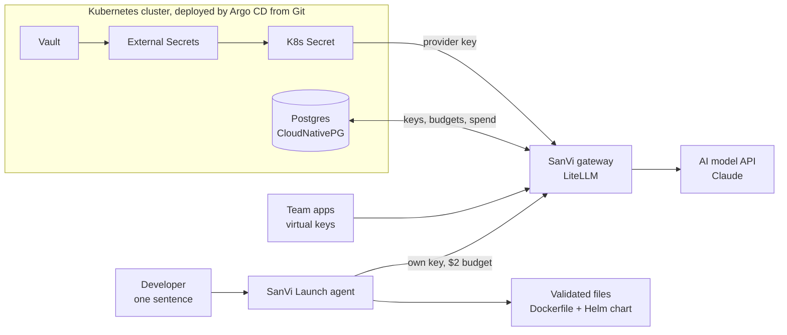

# SanVi

[](https://github.com/sandhilk/sanvi-gateway/actions/workflows/evals.yml)

**An open-source AI platform for Kubernetes.** A gateway that controls how a company uses AI (per-team keys, budgets, rate limits and cost tracking), and an agent that turns one sentence into validated deployment files.

> Personal open-source project, built in the open. Everything listed under "Works today" is running and tested.

## Works today
- **SanVi Gateway**: LiteLLM deployed from Git by one Argo CD root app (app-of-apps)
- **Keys never in code**: the provider key lives only in Vault and is synced in by External Secrets; rotation needs no redeploy
- **Per-team virtual keys** stored in Postgres (CloudNativePG), each with its own models, budget and rate limit
- **SanVi Launch agent**: one sentence in, Dockerfile + Helm chart out, validated with `helm lint`, `kubeconform` and a non-root rule; it feeds errors back and retries (up to 3 attempts)
- **Evals**: 5 fixed prompts (Python, Node, Go, Java); latest run **5/5 passed, avg 1.0 attempts, $0.18 total**

## Architecture


## How a request flows
1. An app calls the gateway with its **virtual key** (OpenAI-compatible API)
2. The gateway checks the key: no key gives 401, a fake key 400, a revoked key 401
3. It checks the key's **budget** and **rate limit**: over the limit gives 429; over budget is blocked
4. It forwards the call with the real provider key, which the app never sees
5. It logs the team, model, tokens and **cost**

## Tested
| Test | Result |
|---|---|
| Secret synced from Vault to Kubernetes | SecretSynced |
| Rotate the key in Vault | Updated in about 70 s, no redeploy |
| Whole platform from one Argo CD root app | All apps Synced and Healthy |
| No key / wrong key / valid key | 401 / 400 / answered |
| Rate limit 2 per minute | 200, 200, 429 |
| Budget exceeded | Blocked: "Budget has been exceeded" |
| Revoke a key | 401 instantly |
| Agent evals (5 prompts) | 5/5 passed, avg 1.0 attempts, $0.18 |

## Run the agent and evals
```bash
export SANVI_AGENT_KEY=<a gateway virtual key>
python3 agent/sanvi_launch.py "Deploy a Python FastAPI service called payments on port 8080 with 2 replicas"
python3 evals/run_evals.py        # exits 1 if the pass rate drops below 80%
```

## Lessons learned
- **Vault dev mode lost every secret on a restart.** The gateway stayed up because External Secrets kept the last good copy in Kubernetes, and Vault was restored from it. Production: HA Vault, persistent storage, auto-unseal.
- **An empty secret "syncs" successfully and fails later.** Validate secrets (length, format) before storing them.
- **Secrets passed as environment variables need a pod restart** after rotation. Production: Reloader.
- **Argo CD polls Git every 3 minutes.** Production: a Git webhook for near-instant sync.

## Roadmap
- **AI access as code**: teams, budgets and model access as YAML in Git, changed by pull request
- **Agent policy gate**: generated infrastructure must pass policy-as-code before a pull request opens
- **Zero static AI keys**: pods authenticate with their Kubernetes ServiceAccount via Vault
- Agent opens pull requests for human review; evals in CI; cost dashboards; one-command Helm install

## Lab notes
Runs on kind (in GitHub Codespaces). Vault runs in dev mode for local learning only. LiteLLM is the gateway engine; SanVi is the platform, security model and agent built around it.

---

Created by **Sandhil Kypa** · Licensed under [Apache 2.0](LICENSE) · See [NOTICE](NOTICE)

## Budget alerts and kill switch

Budgets alone cut a team off at 100% with no warning. SanVi adds two operator tools:

| Tool | What it does | Tested |
|---|---|---|
| `scripts/budget_watch.py` | Lists every key's spend against its budget: **OK**, **WARN** (80%+), **OVER** (100%+). Optional Slack-style webhook via `SANVI_ALERT_WEBHOOK`. Exits 2 when any key is at 80%+, so a CronJob or CI step can alert on it. | Demo key at 85% spend → `WARN team-demo (85%)` |
| `scripts/kill_switch.sh` | Reversible red button: `block <team>`, `block-all`, `unblock <team>`, `unblock-all`, `status`. Keys, budgets and history are kept. | `block team-demo` → **401**; `unblock` → **200** |

Use cases: a leaked key, a runaway agent loop, or an unexpected spend spike, stopped in seconds.
